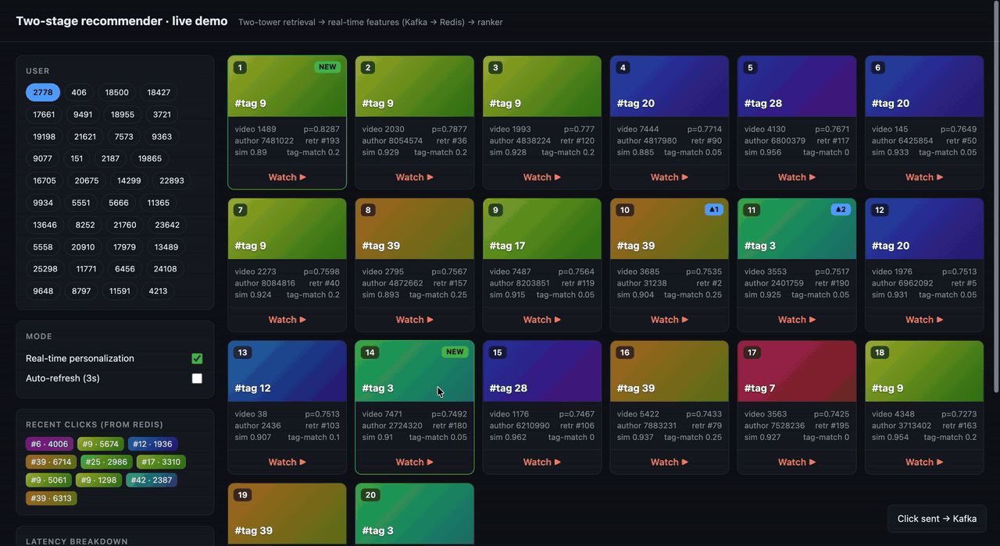
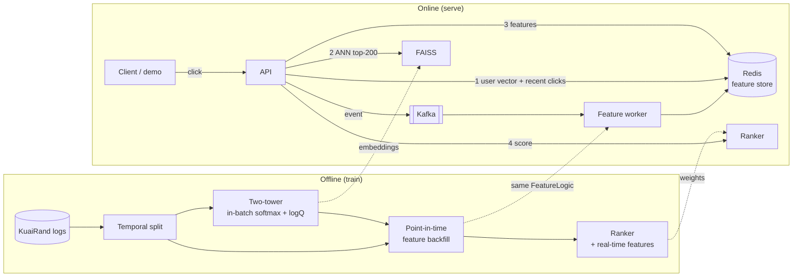

# Real-Time Two-Stage Recommender on KuaiRand

An end-to-end short-video recommender: **two-tower retrieval** and a **deep CTR ranker** trained on [KuaiRand-Pure](https://kuairand.com/) (Kuaishou), served by a **real-time stack** in which user actions stream through **Kafka** into a **Redis feature store** and re-rank the very next feed. Real-time features are defined once and shared by offline training and online serving, so there is no training/serving skew, and a parity test checks it.



*Clicking a video sends an event through Kafka into the Redis feature store; the next request re-ranks the feed (NEW = newly retrieved, ▲ = moved up).*



## Results

<!-- RESULTS START -->
### Retrieval (test period, full-catalog ranking)

| Model | Recall@50 | NDCG@50 | Recall@100 | Recall@50 (cold users, n=209) |
|---|---|---|---|---|
| Popularity baseline | 0.1145 | 0.0433 | 0.1812 | 0.2075 |
| Two-tower, ID embeddings only | 0.1144 | 0.0434 | 0.1812 | 0.2094 |
| Two-tower, no logQ correction | 0.0524 | 0.0168 | 0.0891 | 0.0374 |
| **Two-tower (side features + logQ)** | 0.1780 | 0.0597 | 0.2865 | 0.2440 |

Two-tower vs popularity, Recall@50: **+55.4%**

### Ranking (test period, click prediction)

| Model | AUC | GAUC | LogLoss | AUC on random-exposure log |
|---|---|---|---|---|
| Item CTR baseline | 0.6742 | 0.6106 | 0.6370 | 0.5404 |
| **DNN** (used downstream) | 0.7377 | 0.6436 | 0.6011 | 0.6455 |
| DCN-v2 (DNN + cross layers) | 0.7285 | 0.6257 | 0.6035 | 0.6436 |

### Real-time features (DNN ranker, same data and seed)

| Ranker | Val GAUC | AUC | GAUC | LogLoss | AUC on random-exposure log |
|---|---|---|---|---|---|
| No real-time features | 0.6421 | 0.7370 | 0.6415 | 0.6008 | 0.6452 |
| + all real-time features | 0.6316 | 0.7454 | 0.6260 | 0.5969 | 0.6978 |
| + candidate-level only **(served)** | 0.6482 | 0.7389 | 0.6436 | 0.5899 | 0.6728 |
| + user-level only | 0.6303 | 0.7423 | 0.6263 | 0.6005 | 0.6720 |

Candidate-level features vary across the items in one request; user-level features are constant within a request. Served variant chosen by validation GAUC.

### Serving latency (`./demo.sh loadtest`, single machine, Docker)

| Concurrency | Real-time | QPS | p50 ms | p95 ms | p99 ms | Server: retrieval / features / ranking ms |
|---|---|---|---|---|---|---|
| 1 | yes | 158.1 | 5.14 | 10.22 | 19.76 | 0.22 / 1.3 / 1.81 |
| 8 | yes | 276.7 | 30.68 | 62.71 | 115.21 | 0.65 / 4.0 / 17.35 |
| 32 | yes | 214.6 | 102.06 | 475.27 | 810.8 | 0.99 / 6.55 / 39.03 |
| 8 | no | 215.9 | 27.89 | 75.68 | 222.0 | 0.88 / 1.07 / 27.6 |
<!-- RESULTS END -->

**Key findings**

- **logQ correction is the single biggest lever in retrieval.** Without it, in-batch negatives over-penalize popular videos and the model falls to half of the popularity baseline (Recall@50 0.052 vs. 0.115); with it, two-tower beats popularity by 55%.
- **ID embeddings alone collapse to popularity.** Most users have too little history for a per-user embedding; side features are what let similar users share signal.
- **Explicit feature crosses didn't pay off.** DCN-v2 trailed a plain DNN on this mostly low-cardinality feature set, so the DNN is used downstream.
- **The random-exposure log exposes exposure bias.** Item CTR is strong on the production log (0.674 AUC) but near chance on randomly shown videos (0.540); the learned ranker holds up (0.646).
- **Real-time features: AUC up, GAUC down, until diagnosed.** All seven features raised AUC and random-log AUC (0.645 → 0.698) but lowered GAUC. User-level signals are constant within a request, so they separate heavy clickers from light ones without reordering any one user's feed. Keeping only candidate-level features, chosen by validation GAUC, preserves per-user ranking.

## Modeling

**Data.** KuaiRand-Pure: ~27K users, ~7.5K candidate videos, ~1.4M exposures with click labels, plus user and video side features. It also contains a **random-exposure log** of videos shown at random rather than by Kuaishou's recommender, which makes an unbiased evaluation possible.

**Temporal split.** The last 4 days are test, the 3 days before are validation. A random split would let the model train on the future.

**Retrieval: two-tower.** Each tower combines an ID embedding with side-feature embeddings, an MLP, and an L2-normalized 64-d output scored by dot product, so item vectors can be precomputed into an ANN index.
- *In-batch negatives with sampled softmax*: other positives in the batch serve as negatives.
- *logQ correction*: popular items appear as in-batch negatives more often, so an uncorrected model learns to under-score them. Subtracting log(sampling probability) from each logit removes that bias ([Yi et al., RecSys 2019](https://research.google/pubs/sampling-bias-corrected-neural-modeling-for-large-corpus-item-recommendations/)).
- *Duplicate masking*: a second copy of the positive in the batch is not treated as a negative.

**Ranking.** Every categorical field (user, item, hour, tab, side features) is embedded and fed to a deep MLP, optionally with a DCN-v2 cross network in parallel ([Wang et al., WWW 2021](https://arxiv.org/abs/2008.13535)). On this feature set the explicit cross layers did not beat a plain DNN, so the DNN is the ranker used downstream.

**Evaluation.**
- Retrieval: **full-catalog** Recall@K and NDCG@K (no sampled negatives, which inflate numbers), split by warm and cold users.
- Ranking: **AUC, GAUC and LogLoss**, on both the standard log and the **random-exposure log**. The standard log only contains items the production system already chose; the random log tests ranking on items it would never have shown.
- Baselines: popularity for retrieval, smoothed per-item CTR for ranking.

## Real-time features

Seven short-term signals, all count-windowed (last N events) so a replayed log produces the same values as the original timeline:

| Feature | Meaning |
|---|---|
| `sim_to_recent_clicks` | cosine between the candidate and the mean embedding of the user's last 20 clicks |
| `tag_match_recent`, `author_match_recent` | share of recent clicks with the candidate's tag / author |
| `user_recent_ctr` | user's smoothed CTR over their last 50 exposures |
| `item_recent_ctr`, `item_recent_volume` | item's smoothed CTR and exposure count over its last 200 exposures |
| `user_recent_clicks` | how much short-term history exists |

**One definition, two backends.** `realtime_features.FeatureLogic` computes features from a store; offline it runs on an in-memory store, online on Redis. `tests/test_parity.py` replays the same events through both and asserts identical features.

**Point-in-time backfill.** To train with these features, `build_rt_features.py` merges the standard and random logs into one stream and replays it in event-time order, computing each exposure's features from the state *before* it, then recording it. No feature ever sees its own label or the future.

## Serving

- **Request path** (`serving/engine.py`): user vector from the two-tower, blended with the user's recent-click vector from Redis → FAISS top-200 (already-clicked items removed) → real-time features → ranker → top-20. Each stage is timed and returned with the response.
- **Write-time aggregation**: every candidate needs its item's CTR over the last 200 exposures. Reading those windows on each request meant moving ~40K values per call (p99 over 1 s at 32 concurrent clients). A Redis Lua script now maintains each window's click count and size atomically on write, so a request reads two numbers per candidate with one `HMGET` (43x faster reads); the parity test covers the aggregates too.
- **Streaming**: the API produces click events to Kafka keyed by user id, so each user's events stay ordered on one partition. The worker applies each poll batch to Redis in a single pipelined round trip and tracks Kafka→Redis lag.
- **Bootstrap**: before going live, the train+val history is replayed through the same feature logic and bulk-loaded into Redis, so the online store starts in exactly the state the model expects.
- **Load test**: closed-loop clients at several concurrency levels report QPS, p50/p95/p99 and the server-side stage breakdown.

## Run it

**1. Train** (local, or open `kuairand_recsys_colab.ipynb` in Colab and Run all)

```bash
python -m venv .venv && source .venv/bin/activate
pip install -r requirements.txt
./smoke_test.sh                      # whole pipeline on fake data, ~2 min

mkdir -p data && cd data
curl -L -O https://zenodo.org/records/10439422/files/KuaiRand-Pure.tar.gz
tar -xzf KuaiRand-Pure.tar.gz && cd ..
./run_all.sh                         # experiments + artifacts/ for serving
```

**2. Serve** (needs Docker)

```bash
./demo.sh            # Redis, Kafka, bootstrap, API, worker -> http://localhost:8000
./demo.sh replay     # stream the test period as live traffic
./demo.sh test       # online/offline feature parity test
./demo.sh loadtest   # latency benchmark, then: python make_report.py --update_readme
./demo.sh down
```

| Path | Purpose |
|---|---|
| `prepare_data.py` | ID/feature encoding, temporal split |
| `baselines.py` | Popularity and item-CTR baselines, eval helpers |
| `models.py` | `TwoTower` (in-batch softmax + logQ), `DCNv2` (with optional dense inputs) |
| `train_retrieval.py`, `train_ranking.py` | Offline experiments and ablations |
| `realtime_features.py` | Shared feature logic, in-memory and Redis stores |
| `build_rt_features.py` | Point-in-time backfill, embedding export |
| `train_rt_ranker.py` | Ranker with vs. without real-time features |
| `export_artifacts.py` | Bundles models and data for serving |
| `serving/` | FastAPI app, engine, Kafka worker, bootstrap, replayer, load test, demo page |
| `tests/test_parity.py` | Online/offline feature parity |

## Known limitations

- The ranker is trained on logged exposures but serves retrieval output, a different candidate distribution; end-to-end evaluation of the full pipeline is not done yet.
- The weight that blends recent clicks into the retrieval query (`RT_ALPHA`) is hand-set, not tuned offline.
- The demo uses the current hour and the most common app tab as request context.
- At 7.5K items exact search is already fast; ANN only matters at much larger catalogs.

## Roadmap

- [ ] **Sequential retrieval**: SASRec, then HSTU-style generative retrieval over the watch sequence
- [ ] **Multi-task ranking**: click, long view and like jointly (MMoE)
- [ ] **ANN trade-offs**: HNSW vs. exact search, recall vs. latency (`FAISS_INDEX=hnsw`)
- [ ] **Scale**: KuaiRand-27K (32M videos) with Spark preprocessing and sharded embeddings
